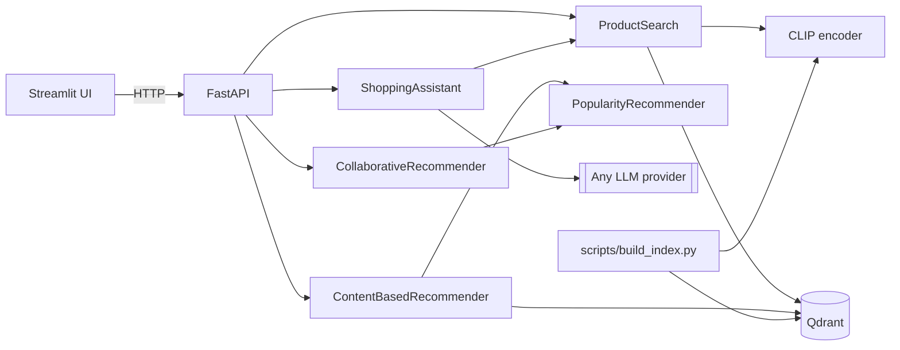

# Clothy — multimodal fashion recommender

A compact, end-to-end recommender for a fashion catalog that combines **vector search**,
**classic recommender algorithms** and an **LLM shopping assistant**:

| Feature | How it works |
|---|---|
| **Text → image search** | The query is embedded with CLIP's text encoder and matched against CLIP image embeddings of every product in Qdrant. |
| **Image search** | An uploaded photo is embedded with CLIP's image encoder and matched the same way. |
| **Content-based recommendations** | A user's *taste vector* — the recency-weighted mean of the embeddings of what they bought — is searched within their favourite categories, excluding past purchases. |
| **Collaborative recommendations** | User-based collaborative filtering: cosine similarity on the sparse user × product purchase matrix; products are scored by the similarity-weighted votes of the nearest neighbours. |
| **Shopping assistant (RAG)** | The LLM turns a message into a structured `SearchIntent` (visual query + category/brand/colour/price/rating filters), Qdrant retrieves matching products, and the answer is grounded only in those products. |

Cold-start users fall back to a Bayesian-average popularity ranking.

## Architecture



```
src/clothes_recommender/
├── config.py          # Settings from env / .env (pydantic-settings)
├── domain.py          # Product, User, Purchase, ProductFilter, Encoder protocol
├── catalog.py         # Product catalog + customer data access
├── embeddings.py      # CLIP encoder (lazy-loaded)
├── vector_store.py    # Qdrant wrapper: upsert, filtered search, vector lookup
├── search.py          # Text and image search
├── recommenders/      # content_based, collaborative, popularity
├── chat/              # llm (provider-agnostic), intent, prompts, assistant
├── services.py        # Composition root
├── api.py             # FastAPI app
└── ui.py              # Streamlit client
scripts/build_index.py # Download images, embed with CLIP, upsert into Qdrant
```

## Quick start

Requires [uv](https://docs.astral.sh/uv/) and Python 3.13.

```bash
uv sync --all-extras
cp .env.example .env                                   # optional: configure an LLM for the chat tab

uv run python -m scripts.build_index --limit 2000      # quick demo index
uv run uvicorn clothes_recommender.api:create_app --factory --reload   # http://localhost:8000/docs
uv run streamlit run src/clothes_recommender/ui.py     # http://localhost:8501
```

Without `--limit` the whole catalog is indexed. Qdrant runs embedded (stored in `.qdrant/`)
unless `QDRANT_URL` is set, so no external service is needed. Embedded Qdrant allows one
process at a time: build the index before starting the API (or point both at a Qdrant server).

### Docker

```bash
docker compose up --build
docker compose exec api python -m scripts.build_index --limit 2000
```

### LLM configuration

The assistant works with any LangChain chat provider, configured only through `.env`:

```bash
LLM_PROVIDER=openai                       # openai | anthropic | azure_openai | ...
LLM_MODEL=gpt-4.1-mini
LLM_API_KEY=sk-...
LLM_BASE_URL=                             # set for OpenAI-compatible gateways
```

Any OpenAI-compatible gateway (OmniRoute, OpenRouter, LiteLLM, Ollama, vLLM) works with
`LLM_PROVIDER=openai` plus `LLM_BASE_URL`. Without `LLM_MODEL` every feature except chat still works.

## API

| Method | Path | Description |
|---|---|---|
| GET | `/health` | Index size and whether chat is enabled |
| GET | `/products/{id}` | Product details |
| POST | `/search/text` | `{"query": "red floral dress", "top_k": 10}` |
| POST | `/search/image` | Multipart image upload |
| GET | `/users`, `/users/{id}` | User ids; profile with purchase history |
| GET | `/users/{id}/recommendations?strategy=content\|collaborative` | Personalised recommendations |
| GET | `/users/{id}/similar` | Most similar shoppers |
| POST | `/chat` | `{"message": "...", "history": [...]}` |

Interactive docs at `http://localhost:8000/docs`.

## Development

```bash
uv run pytest                        # fast, offline unit tests (fake encoder, in-memory Qdrant, fake LLM)
uv run pytest -m integration        # tests that download the real CLIP model
uv run ruff check . && uv run ruff format --check .
```
