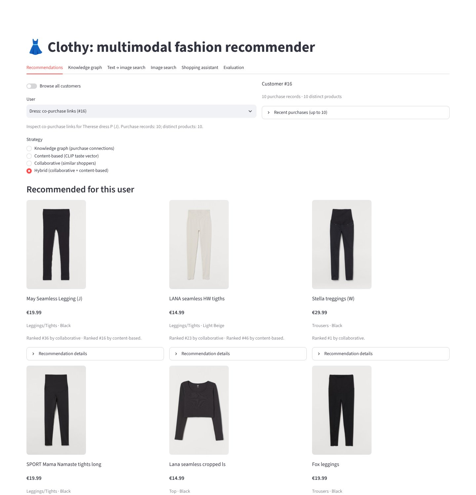
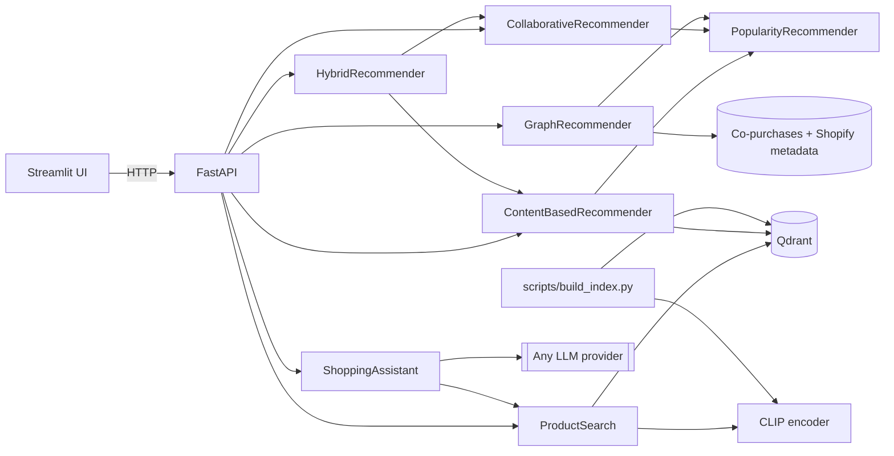

# Clothy: multimodal fashion recommender

Clothy is an end-to-end recommender built on real H&M purchase data. It combines CLIP vector
search, classic and graph recommendations, and an LLM shopping assistant:

| Feature | How it works |
|---|---|
| Text-to-image search | The query is embedded with CLIP's text encoder and compared with the CLIP image embeddings of every product in Qdrant. |
| Image search | An uploaded photo is embedded with CLIP's image encoder and compared the same way. Example photos show H&M garments outside the sampled catalog, so every match is a different product. |
| Visually similar products | A product's own image embedding is the query (CLIP item-to-item), shown next to the graph's co-purchase complements and alternatives. |
| Content-based recommendations | Each user has a *taste vector*, the recency-weighted mean of the embeddings of the products they bought. It is searched within the broad product groups the user buys most, excluding past purchases. |
| Collaborative recommendations | User-based collaborative filtering. Users are compared by cosine similarity on the sparse user × product purchase matrix, and each product is scored by the similarity-weighted votes of the nearest neighbours. |
| Hybrid recommendations | Reciprocal rank fusion of the collaborative and content-based lists: who bought what, plus what it looks like. Each result names its rank in both lists. |
| Graph recommendations | Past purchases seed an in-memory graph of co-purchases, Shopify categories and attributes. Shared attributes are weighted by inverse degree; each result includes its evidence. |
| Knowledge graph | Explore a product's category, attributes and co-purchased neighbors, with complementary products and higher-priced alternatives. |
| Offline evaluation | Every strategy is trained on purchases before a cutoff and scored on the following week (MAP@12, catalog coverage); the Evaluation tab compares them. |
| Shopping assistant (RAG) | The LLM turns a message into a structured `SearchIntent`: a visual query plus product type, section (e.g. Menswear), colour and price filters. Qdrant retrieves the matching products, and the answer cites only those products. |

Users without usable purchase history get the products bought most in the last two weeks of
data, which also fill collaborative lists that come up short.

The demo opens with up to ten customer examples selected from the loaded data for useful
purchase connections, specific product categories and varied shopping histories. Each has
a descriptive label and a suggested product to explore. “Browse all customers” keeps every
other customer accessible; no users are removed. These examples guide exploration and do
not determine the offline evaluation cohort.

## Screenshots

Captured on the default sample (5,000 customers, 14,300 products) with
`scripts/take_screenshots.py --example 1`, a customer who buys dresses and leggings.

### Recommendations: hybrid

Collaborative filtering and the CLIP taste vector each rank 50 candidates; reciprocal rank
fusion promotes products both lists agree on, even when neither ranks them first.



The same customer under the [knowledge graph](docs/screenshots/recommendations-graph.jpg),
[content-based](docs/screenshots/recommendations-content.jpg) and
[collaborative](docs/screenshots/recommendations-collaborative.jpg) strategies.

### Evaluation

Trained on purchases before 2020-09-16, scored on what 819 customers bought in the
following seven days. Content-based recommendations alone score below best-sellers, but
fused with collaborative filtering they lift it from 1.75x to 2.06x the popularity baseline.


### Text-to-image search

"striped summer dress" is compared with product photos only; names and descriptions are not
searched.


### Image search

The query is an example photo of a grey sweater that is not in the catalog; the results are
other grey knits.


### Knowledge graph and look-alikes

A purchased dress with its attributes, category and co-purchase links. "Looks similar" lists
the nearest product photos, which needs no purchase history.


Theme and layout captures of the graph explorer:
[dark](docs/screenshots/knowledge-graph-dark-desktop.png),
[light](docs/screenshots/knowledge-graph-light-desktop.png),
[narrow](docs/screenshots/knowledge-graph-dark-narrow.png).

## Data

The app uses the [H&M Personalized Fashion Recommendations](https://www.kaggle.com/competitions/h-and-m-personalized-fashion-recommendations)
dataset from Kaggle: 105k articles with photos and 31.8M real purchases from 2018 to 2020.
`scripts/prepare_data.py` keeps the last 12 weeks of transactions, samples 5,000 customers
with at least five purchases, and extracts the photos of the products they bought.
It also writes `co_purchases.parquet`: links between catalog products learned from all
shoppers in that window, including shoppers outside the demo sample. Repeated purchases
of one item count once per basket; pairs need at least two shared baskets.

The dataset's prices are normalised. Multiplying them by 590 (a convention from the Kaggle
competition discussion) gives realistic euro price points such as €29.99, so the prices shown
are approximations. H&M licenses the data for non-commercial research use, so it is not part
of this repository.

### Shopify enrichment and graph behavior

The saved mapping in `taxonomy/hm_shopify_categories.json` assigns H&M product types to
Shopify's pinned `2026-05` taxonomy. Colour, pattern, gender and age attributes use explicit
field mappings. Ambiguous types and values stay unmapped. The classification script uses
conservative exact matches, then CLIP/word-overlap candidates and an LLM decision; its
results need review. Normal data preparation and graph recommendations make no LLM calls.
Older prepared catalogs without enrichment still load, using empty attributes and an
uncategorized category until the data is prepared again.

Graph scores sum co-purchase lift and shared-feature evidence across distinct past
purchases. A shared feature contributes `1 / (degree - 1)`, reducing the influence of
common attributes. Popularity fills short lists. Scores are ranking signals, not purchase
probabilities, and this baseline has not established a quality improvement.

The dataset has no basket ID: one customer on one day is a basket proxy. Complementary
suggestions require co-purchase evidence across different product groups. Higher-priced
alternatives require the same specific Shopify category, product type and section, with no
conflicting mapped gender/age attributes. Broad or unclassified categories return no
alternatives. Price does not establish quality or upsell value.

## Architecture



```
src/clothes_recommender/
├── config.py          # Settings from env / .env (pydantic-settings)
├── domain.py          # Product, User, Purchase, ProductFilter, Encoder protocol
├── catalog.py         # Product catalog + customer data access
├── embeddings.py      # CLIP encoder (lazy-loaded)
├── vector_store.py    # Qdrant wrapper: upsert, filtered search, vector lookup
├── search.py          # Text and image search
├── recommenders/      # content_based, collaborative, graph, hybrid, popularity
├── chat/              # llm (provider-agnostic), intent, prompts, assistant
├── services.py        # Composition root
├── api.py             # FastAPI app
└── ui.py              # Streamlit client
scripts/prepare_data.py # Sample the H&M Kaggle archive (or its unzipped CSVs) into data/
scripts/fetch_photos.py # Download the sampled products' photos from the mirror
scripts/fetch_query_photos.py # Example image-search photos of garments outside the catalog
scripts/build_index.py # Embed product photos with CLIP, upsert into Qdrant
scripts/classify_product_types.py # Reviewable H&M-to-Shopify category decisions
scripts/evaluate.py # Chronological holdout evaluation; JSON results for the Evaluation tab
scripts/take_screenshots.py # Re-capture the README screenshots with Playwright
```

## Quick start

Requires [uv](https://docs.astral.sh/uv/) and Python 3.13.

```bash
uv sync --all-extras
cp .env.example .env                                   # optional: configure an LLM for the chat tab
```

Get the H&M data in one of two ways. The Kaggle archive needs a free account with the
[competition rules](https://www.kaggle.com/competitions/h-and-m-personalized-fashion-recommendations/rules)
accepted and an API token in `~/.kaggle/kaggle.json`; the download is about 30 GB.

```bash
uvx kaggle competitions download -c h-and-m-personalized-fashion-recommendations -p data/raw
uv run python -m scripts.prepare_data                  # photos are extracted from the zip
```

Without a Kaggle account, use the CSVs (3.7 GB) of the
[Hugging Face mirror](https://huggingface.co/datasets/einrafh/hnm-fashion-recommendations-data)
and fetch only the photos of the sampled products (about 35 minutes for the 14,300 products
of the default sample, 360 MB after downsizing):

```bash
M=https://huggingface.co/datasets/einrafh/hnm-fashion-recommendations-data/resolve/acde210b0090be673abdba5f989c48925c856f78/data/raw
mkdir -p data/raw && for f in articles customers transactions_train; do curl -L -o data/raw/$f.csv $M/$f.csv; done
uv run python -m scripts.prepare_data --archive data/raw
uv run python -m scripts.fetch_photos --data-dir data --workers 8
```

Then build the image index, fetch a few example photos for image search, and start the app:

```bash
uv run python -m scripts.build_index                   # all products: ~5 min at 50 img/s on 4 CPU cores
uv run python -m scripts.fetch_query_photos --articles data/raw/articles.csv
uv run python -m scripts.evaluate --qdrant-path .qdrant --output data/evaluation.json
uv run uvicorn clothes_recommender.api:create_app --factory --reload   # http://localhost:8000/docs
uv run streamlit run src/clothes_recommender/ui.py     # http://localhost:8501
```

The example photos show H&M garments that are not in the sampled catalog, so image search
always has to find a different product that looks alike. `scripts.evaluate` writes the
results that the Evaluation tab shows; without it, that tab explains how to create them.

`build_index --limit N` indexes a smaller subset spread across sections. Qdrant runs
embedded (stored in `.qdrant/`) unless `QDRANT_URL` is set, so no external service is needed.
Embedded Qdrant allows one process at a time: build the index and run the evaluation before
starting the API (or point everything at a Qdrant server).

### Docker

```bash
docker compose up --build
docker compose exec api python -m scripts.build_index --limit 3000
```

### LLM configuration

The assistant works with any LangChain chat provider, configured only through `.env`:

```bash
LLM_PROVIDER=openai                       # openai | anthropic | azure_openai | ...
LLM_MODEL=gpt-4.1-mini
LLM_API_KEY=sk-...
LLM_BASE_URL=                             # set for OpenAI-compatible gateways
```

Any OpenAI-compatible gateway (OmniRoute, OpenRouter, LiteLLM, Ollama, vLLM) works with
`LLM_PROVIDER=openai` plus `LLM_BASE_URL`. Without `LLM_MODEL` every feature except chat still works.

## API

| Method | Path | Description |
|---|---|---|
| GET | `/health` | Index size and whether chat is enabled |
| GET | `/products/{id}` | Product details |
| GET | `/products/{id}/graph` | Bounded product neighborhood: nodes and edges |
| GET | `/products/{id}/related?kind=complement\|alternative` | Co-purchased complements or higher-priced alternatives |
| GET | `/products/{id}/similar` | Products whose photos look most alike (CLIP item-to-item) |
| GET | `/sections` | Catalog sections, for filtering text search |
| POST | `/search/text` | `{"query": "red floral dress", "top_k": 10, "section": "Ladieswear"}` (section optional) |
| POST | `/search/image` | Multipart image upload |
| GET | `/search/examples`, `/search/examples/{id}/image` | Example query photos of garments outside the catalog |
| GET | `/users`, `/users/{id}` | User ids; profile with purchase history |
| GET | `/demo/customers` | Up to ten descriptive customer examples and starting products |
| GET | `/users/{id}/recommendations?strategy=content\|collaborative\|graph` | Personalised recommendations; graph hits include reasons |
| GET | `/users/{id}/similar` | Most similar shoppers |
| POST | `/chat` | `{"message": "...", "history": [...]}` |
| GET | `/evaluation` | Offline evaluation results saved by `scripts.evaluate --output` |

Interactive docs at `http://localhost:8000/docs`.

## Offline evaluation

```bash
uv run python -m scripts.evaluate --data-dir data
# Content-based and hybrid recommendations need an explicitly chosen matching image index;
# --output saves the JSON that GET /evaluation and the Evaluation tab show:
uv run python -m scripts.evaluate --data-dir data --qdrant-path .qdrant --output data/evaluation.json
```

Results on the default sample (5,000 customers, seed 42; 819 customers with purchases in
the holdout week, 794 of them buying something new):

| Strategy | MAP@12, new items | vs popularity | MAP@12, all purchases | Catalog coverage |
|---|---|---|---|---|
| Hybrid (collaborative + content-based) | 0.0103 | 2.06x | 0.0100 | 29.4% |
| Collaborative | 0.0088 | 1.75x | 0.0085 | 29.2% |
| Knowledge graph | 0.0077 | 1.53x | 0.0074 | 26.8% |
| Popularity | 0.0050 | 1.00x | 0.0049 | 0.1% |
| Content-based | 0.0046 | 0.91x | 0.0044 | 25.5% |

The hybrid pairing was chosen on this same holdout: collaborative + content-based scored
better than collaborative + graph (0.0094) or all three (0.0096). RRF's constant stays at the
standard 60 rather than the slightly better 10 (0.0110). With one sample and one holdout
week, treat differences of a few percent as noise.

The last seven calendar days are held out. Popularity, collaborative filtering and
co-purchase links are rebuilt using training purchases only; the evaluator never reuses
the full-window links file. JSON output includes MAP@12, catalog coverage and list fill.
Full-holdout and novel-item scores are separate because current recommenders exclude
previous purchases. Users without both training and holdout purchases are excluded.

The prepared sample and catalog can reflect the full observation window, so these are
sample-level results, not a population estimate or a competition leaderboard score.
Evaluation learns links from the prepared shoppers only; production preparation uses all
shoppers. CLIP image vectors are fixed features, but index provenance is not recorded.

The development workflow and remaining validation are recorded in
[engineering workflow](docs/engineering-workflow.md).

## Development

```bash
uv run pytest                        # fast, offline unit tests (fake encoder, in-memory Qdrant, fake LLM)
uv run pytest -m integration        # tests that download the real CLIP model
uv run ruff check . && uv run ruff format --check .

# Re-capture README screenshots (API + UI running; uses the local Google Chrome)
uv run python -m scripts.take_screenshots --example 1 --skip-chat
```
