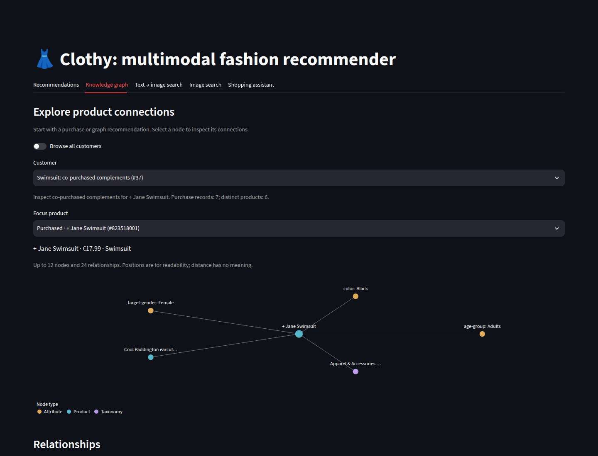
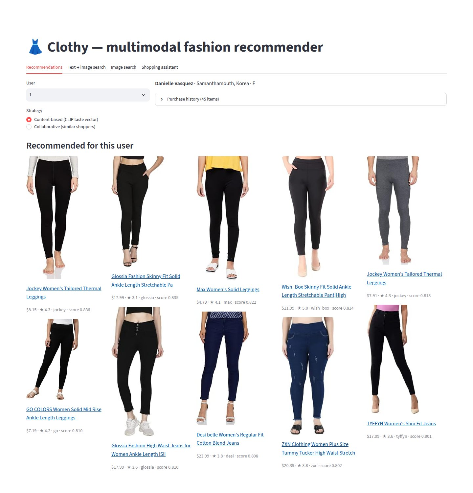
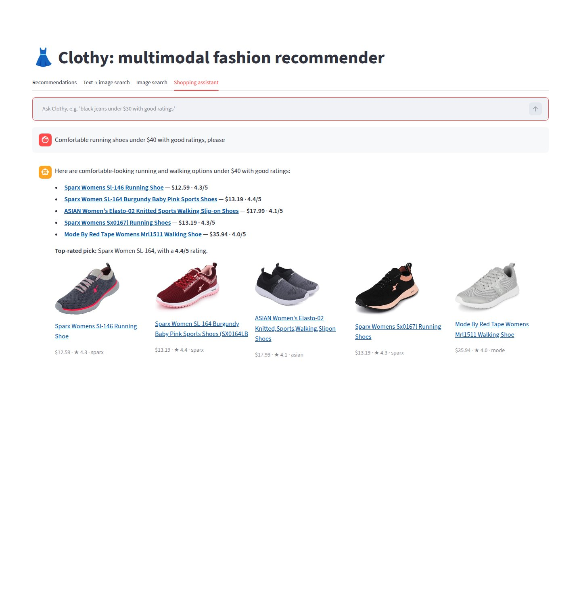
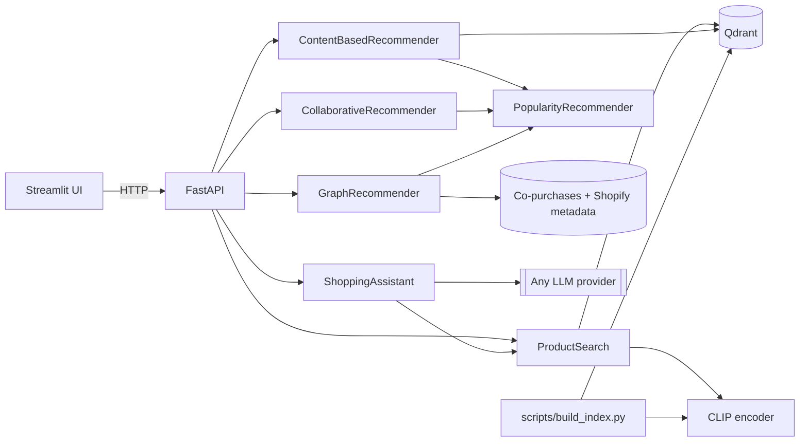

# Clothy: multimodal fashion recommender

Clothy is an end-to-end recommender built on real H&M purchase data. It combines CLIP vector
search, classic and graph recommendations, and an LLM shopping assistant:

| Feature | How it works |
|---|---|
| Text-to-image search | The query is embedded with CLIP's text encoder and compared with the CLIP image embeddings of every product in Qdrant. |
| Image search | An uploaded photo is embedded with CLIP's image encoder and compared the same way. |
| Content-based recommendations | Each user has a *taste vector*, the recency-weighted mean of the embeddings of the products they bought. It is searched within the broad product groups the user buys most, excluding past purchases. |
| Collaborative recommendations | User-based collaborative filtering. Users are compared by cosine similarity on the sparse user × product purchase matrix, and each product is scored by the similarity-weighted votes of the nearest neighbours. |
| Graph recommendations | Past purchases seed an in-memory graph of co-purchases, Shopify categories and attributes. Shared attributes are weighted by inverse degree; each result includes its evidence. |
| Knowledge graph | Explore a product's category, attributes and co-purchased neighbors, with complementary products and higher-priced alternatives. |
| Shopping assistant (RAG) | The LLM turns a message into a structured `SearchIntent`: a visual query plus product type, section (e.g. Menswear), colour and price filters. Qdrant retrieves the matching products, and the answer cites only those products. |

Users without usable purchase history get the products bought most in the last two weeks of
data, which also fill collaborative lists that come up short.

The demo opens with up to ten customer examples selected from the loaded data for useful
purchase connections, specific product categories and varied shopping histories. Each has
a descriptive label and a suggested product to explore. “Browse all customers” keeps every
other customer accessible; no users are removed. These examples guide exploration and do
not determine the offline evaluation cohort.

## Screenshots

### Knowledge graph on the H&M sample

The default curated example opens on a purchased swimsuit, showing its mapped attributes
and a real co-purchase link. This capture uses the local 200-customer development sample;
the graph does not depend on product photos.



### Earlier interface captures

These captures predate the H&M migration and show the legacy Amazon catalog and synthetic
shoppers. They illustrate the earlier interface, not H&M recommendation quality or the new
graph explorer. Re-capture them after preparing the H&M photos and rebuilding the index.

### Content-based recommendations

The taste vector built from this shopper's 45 purchases retrieves visually similar items, mostly leggings and slim-fit jeans.



### Collaborative recommendations

Products bought by the most similar shoppers. The demo shoppers and their purchases are synthetic, so similarity between neighbours is low (about 0.06).


### Text-to-image search

The query "red floral summer dress" is compared with product photos directly; product titles are not searched.


### Image search

The query photo is a dress that is not in the index. The closest match is a maxi dress from the same brand, followed by other floral dresses.


### Shopping assistant

The LLM extracts the intent (category, maximum price, minimum rating), Qdrant applies it as a metadata filter, and the answer cites only the retrieved products.



## Data

The app uses the [H&M Personalized Fashion Recommendations](https://www.kaggle.com/competitions/h-and-m-personalized-fashion-recommendations)
dataset from Kaggle: 105k articles with photos and 31.8M real purchases from 2018 to 2020.
`scripts/prepare_data.py` keeps the last 12 weeks of transactions, samples 5,000 customers
with at least five purchases, and extracts the photos of the products they bought.
It also writes `co_purchases.parquet`: links between catalog products learned from all
shoppers in that window, including shoppers outside the demo sample. Repeated purchases
of one item count once per basket; pairs need at least two shared baskets.

The dataset's prices are normalised. Multiplying them by 590 (a convention from the Kaggle
competition discussion) gives realistic euro price points such as €29.99, so the prices shown
are approximations. H&M licenses the data for non-commercial research use, so it is not part
of this repository.

### Shopify enrichment and graph behavior

The saved mapping in `taxonomy/hm_shopify_categories.json` assigns H&M product types to
Shopify's pinned `2026-05` taxonomy. Colour, pattern, gender and age attributes use explicit
field mappings. Ambiguous types and values stay unmapped. The classification script uses
conservative exact matches, then CLIP/word-overlap candidates and an LLM decision; its
results need review. Normal data preparation and graph recommendations make no LLM calls.
Older prepared catalogs without enrichment still load, using empty attributes and an
uncategorized category until the data is prepared again.

Graph scores sum co-purchase lift and shared-feature evidence across distinct past
purchases. A shared feature contributes `1 / (degree - 1)`, reducing the influence of
common attributes. Popularity fills short lists. Scores are ranking signals, not purchase
probabilities, and this baseline has not established a quality improvement.

The dataset has no basket ID: one customer on one day is a basket proxy. Complementary
suggestions require co-purchase evidence across different product groups. Higher-priced
alternatives require the same specific Shopify category, product type and section, with no
conflicting mapped gender/age attributes. Broad or unclassified categories return no
alternatives. Price does not establish quality or upsell value.

## Architecture



```
src/clothes_recommender/
├── config.py          # Settings from env / .env (pydantic-settings)
├── domain.py          # Product, User, Purchase, ProductFilter, Encoder protocol
├── catalog.py         # Product catalog + customer data access
├── embeddings.py      # CLIP encoder (lazy-loaded)
├── vector_store.py    # Qdrant wrapper: upsert, filtered search, vector lookup
├── search.py          # Text and image search
├── recommenders/      # content_based, collaborative, graph, popularity
├── chat/              # llm (provider-agnostic), intent, prompts, assistant
├── services.py        # Composition root
├── api.py             # FastAPI app
└── ui.py              # Streamlit client
scripts/prepare_data.py # Sample the H&M Kaggle archive into data/
scripts/build_index.py # Embed product photos with CLIP, upsert into Qdrant
scripts/classify_product_types.py # Reviewable H&M-to-Shopify category decisions
scripts/evaluate.py # Chronological holdout evaluation; JSON results
scripts/take_screenshots.py # Re-capture the README screenshots with Playwright
```

## Quick start

Requires [uv](https://docs.astral.sh/uv/) and Python 3.13.

The dataset needs a free Kaggle account with the
[competition rules](https://www.kaggle.com/competitions/h-and-m-personalized-fashion-recommendations/rules)
accepted and an API token in `~/.kaggle/kaggle.json`. The download is about 30 GB.

```bash
uv sync --all-extras
cp .env.example .env                                   # optional: configure an LLM for the chat tab

uvx kaggle competitions download -c h-and-m-personalized-fashion-recommendations -p data/raw
uv run python -m scripts.prepare_data

uv run python -m scripts.build_index --limit 3000      # demo index: ~2.5 min on a 20-core CPU
uv run uvicorn clothes_recommender.api:create_app --factory --reload   # http://localhost:8000/docs
uv run streamlit run src/clothes_recommender/ui.py     # http://localhost:8501
```

Without `--limit` the whole catalog is indexed. Qdrant runs embedded (stored in `.qdrant/`)
unless `QDRANT_URL` is set, so no external service is needed. Embedded Qdrant allows one
process at a time: build the index before starting the API (or point both at a Qdrant server).

### Docker

```bash
docker compose up --build
docker compose exec api python -m scripts.build_index --limit 3000
```

### LLM configuration

The assistant works with any LangChain chat provider, configured only through `.env`:

```bash
LLM_PROVIDER=openai                       # openai | anthropic | azure_openai | ...
LLM_MODEL=gpt-4.1-mini
LLM_API_KEY=sk-...
LLM_BASE_URL=                             # set for OpenAI-compatible gateways
```

Any OpenAI-compatible gateway (OmniRoute, OpenRouter, LiteLLM, Ollama, vLLM) works with
`LLM_PROVIDER=openai` plus `LLM_BASE_URL`. Without `LLM_MODEL` every feature except chat still works.

## API

| Method | Path | Description |
|---|---|---|
| GET | `/health` | Index size and whether chat is enabled |
| GET | `/products/{id}` | Product details |
| GET | `/products/{id}/graph` | Bounded product neighborhood: nodes and edges |
| GET | `/products/{id}/related?kind=complement\|alternative` | Co-purchased complements or higher-priced alternatives |
| POST | `/search/text` | `{"query": "red floral dress", "top_k": 10}` |
| POST | `/search/image` | Multipart image upload |
| GET | `/users`, `/users/{id}` | User ids; profile with purchase history |
| GET | `/demo/customers` | Up to ten descriptive customer examples and starting products |
| GET | `/users/{id}/recommendations?strategy=content\|collaborative\|graph` | Personalised recommendations; graph hits include reasons |
| GET | `/users/{id}/similar` | Most similar shoppers |
| POST | `/chat` | `{"message": "...", "history": [...]}` |

Interactive docs at `http://localhost:8000/docs`.

## Offline evaluation

```bash
uv run python -m scripts.evaluate --data-dir data
# Include content-based recommendations only with an explicitly chosen matching image index:
uv run python -m scripts.evaluate --data-dir data --qdrant-path .qdrant
```

The last seven calendar days are held out. Popularity, collaborative filtering and
co-purchase links are rebuilt using training purchases only; the evaluator never reuses
the full-window links file. JSON output includes MAP@12, catalog coverage and list fill.
Full-holdout and novel-item scores are separate because current recommenders exclude
previous purchases. Users without both training and holdout purchases are excluded.

The prepared sample and catalog can reflect the full observation window, so these are
sample-level results, not a population estimate or a competition leaderboard score.
Evaluation learns links from the prepared shoppers only; production preparation uses all
shoppers. CLIP image vectors are fixed features, but index provenance is not recorded.

The development workflow and remaining validation are recorded in
[engineering workflow](docs/engineering-workflow.md).

## Development

```bash
uv run pytest                        # fast, offline unit tests (fake encoder, in-memory Qdrant, fake LLM)
uv run pytest -m integration        # tests that download the real CLIP model
uv run ruff check . && uv run ruff format --check .

# Re-capture README screenshots (API + UI running; uses the local Google Chrome)
uv run python -m scripts.take_screenshots --query-image path/to/garment.jpg
```
