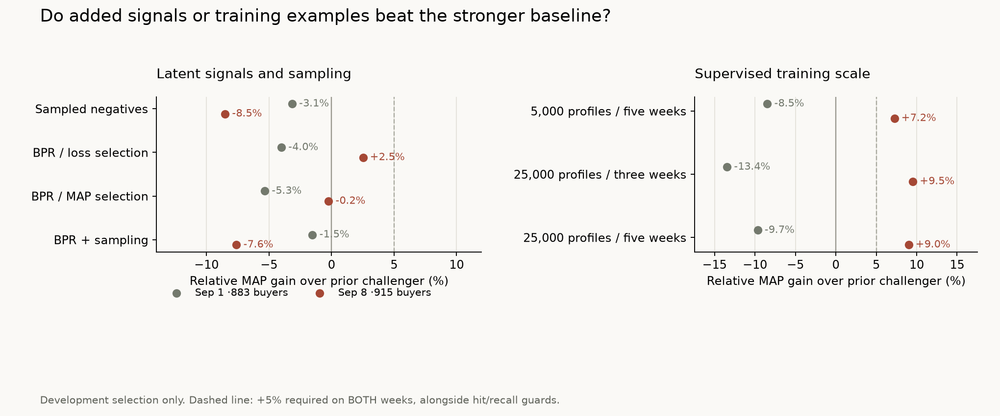

# Ranking iteration: latent signals and supervised scale — 2026-10-29

**No new arm passed the predeclared improvement rule on both development weeks.**
Seven new designs tested BPR, recalled-negative sampling, more training customers
and more labeled weeks. None justified consuming the new confirmation cohort.
The serving model remains unchanged; the newly reserved 20,000 shoppers are unscored.



## Research that led to the tests

The [original third-place report](https://www.kaggle.com/competitions/h-and-m-personalized-fashion-recommendations/discussion/324129)
uses BPR features and downsampling of recalled negatives. That justified testing
these interventions here, without assuming the author's gains transfer. Our prior
SVD signal was not BPR. The [original BPR paper](https://arxiv.org/abs/1205.2618)
describes pairwise learning from implicit feedback. The [first-place report](https://www.kaggle.com/c/h-and-m-personalized-fashion-recommendations/discussion/324070)
uses six labeled training weeks and last-week validation, motivating a separate
supervision-scale test.

Millions of crowd transactions build retrieval signals, but the old ranker saw
only **1,374 / 1,491 recalled positive training rows across its three labeled weeks**.
More history, more supervised customers and more labeled snapshots are different
interventions. Five labeled weeks is a bounded test using available July history,
not a reproduction of the competition winner.

## Fixed comparison and decision rule

The evaluation endpoints remain September 1 / 8, with 883 / 915 active eligible buyers
from the original 5,000 profiles. These are **already inspected development weeks**.
All arms rank identical expanded candidate pools against full unique catalog-purchase
truth, including repeats and unreachable positives. No missing positive is injected.
Median pool sizes are 156 / 158; reachable truth is 533 / 3,251 and 559 / 3,268 pairs.

Initial training excludes the latest prior label week, which selects rounds;
final refitting includes all requested prior label weeks. Target labels never fit
or stop a model. Tree capacity is fixed: 400 rounds maximum, patience 30, 31 leaves,
depth 6, min leaf 50, learning rate .05, L2=1, seed 42, two threads. Freshly refitted v1 and buy-again
controls, plus the previous loss-selection challenger, reproduce the recorded MAP
scores to within 1e-12. No serving artifacts or project runtime dependencies changed.

Before outcome inspection, the rule required a new arm to exceed the strongest
previous loss-selection challenger by **at least 5% relative MAP on both endpoints**,
with no hit-rate or macro-recall decrease against v1. Choose the greatest equal-week
mean MAP only among qualifying arms, freeze it, then test one design on the reserved
cohort. No qualifier means no new confirmation. The 5% rule is a practical selection
criterion, not a significance test.

## BPR and negative sampling

| Approach | Sep 1 MAP@12 | Sep 8 MAP@12 |
| --- | ---: | ---: |
| Fresh v1 | 0.028577 | 0.030524 |
| Previous loss-selection challenger | 0.031426 | 0.033558 |
| Full rows, MAP selection control | 0.031352 | 0.030757 |
| Sampled negatives, MAP selection | 0.030436 | 0.030704 |
| BPR features, loss selection | 0.030167 | 0.034404 |
| BPR features, MAP selection | 0.029749 | 0.033480 |
| BPR + sampled negatives, MAP selection | 0.030947 | 0.031009 |

BPR adds native dot/bias score, reciprocal candidate rank and a known-vector flag
to 24 existing features. Fits use binary crowd interactions before each cutoff,
with the explicit user→shopper crosswalk. Settings: implicit 0.7.3 CPU, 64 requested
factors plus native bias, 50 epochs, learning rate .05, regularization .01, seed 42, one thread,
verified negatives. Missing vectors yield zeros; owned products remain eligible.

The [versioned native implementation](https://github.com/benfred/implicit/blob/v0.7.3/implicit/cpu/bpr.pyx)
samples BPR negatives through observed item entries and checks prior purchases.
This differs from our ranker-row sampling: uniform without replacement, at most
30 negatives per recalled positive, all recalled positives retained, seed 42,
original row order preserved. Validation and evaluation rows stay complete.
Refit rows fell 369,956→42,594 and 392,379→46,221 while retaining all 1,374 / 1,491 positives.
The full-MAP control separates sampling from the changed early-stopping metric.

BPR loss selection helped only the second endpoint; sampling did not beat its
full-row MAP-selection control on either. These bounded results do not establish
that BPR or sampling can never help under another retrieval or supervision design.

## Supervised cohort and labeled-window ablation

Training preserves the original 5,000 profiles and adds 20,000 shoppers, uniformly
sampled from sorted eligible shopper IDs with seed 20261030. Eligibility is at least
one catalog purchase **strictly before July 22**, the first five-week label period.
Exclude all 45,000 original, spent-confirmation and newly reserved shopper IDs.
There were 166,556 unexcluded eligible shoppers. Original IDs/history and an explicit
unique shopper crosswalk are preserved; added unused ages are missing. Supervised
events stop September 1. Catalog and crowd files match the enriched source exactly.

Every arm selects rounds on the same **original-only latest prior validation week**.
Expanded arms add supervision to earlier fitting weeks and final refitting, without
changing the stopping cohort, target customers, candidate pools or full truth.
Three-week ends are August 11 / 18 / 25 for Sep 1 and August 18 / 25 / Sep 1 for Sep 8; five-week
arms add two earlier ends. Repeated customers/items make rows dependent examples.

| Training arm | Sep 1 MAP@12 | Sep 8 MAP@12 |
| --- | ---: | ---: |
| Original 5,000 profiles / three weeks | 0.031426 | 0.033558 |
| Original 5,000 profiles / five weeks | 0.028765 | 0.035990 |
| 25,000 profiles / three weeks | 0.027201 | 0.036754 |
| 25,000 profiles / five weeks | 0.028390 | 0.036580 |

Recalled positive rows / total training candidate rows across all requested snapshots:

| Training arm | For Sep 1 | For Sep 8 |
| --- | ---: | ---: |
| Original / three | 1,374 / 369,956 | 1,491 / 392,379 |
| Original / five | 2,062 / 571,603 | 2,276 / 616,387 |
| Expanded / three | 5,198 / 1,490,229 | 5,429 / 1,552,196 |
| Expanded / five | 8,657 / 2,521,847 | 8,801 / 2,580,423 |

Exact hit rates, macro recalls, iteration counts and paired per-customer MAP 95%
intervals are in the [aggregate evidence](research/iteration2.json). Development
intervals describe these reused weeks; they do not correct for earlier trials,
repeated customers or model selection. More supervision is not a guaranteed gain.

The expanded three-week arm reached
.036754 on September 8 (+9.5% versus the stronger challenger), but fell to .027201
on September 1 (−13.4%). Its paired MAP intervals versus that challenger were
[−.008210, −.000754] and [−.000718, +.007431], respectively. The sign reversal
is concrete; its cause is not isolated by this experiment. Changes in customer mix,
temporal behavior, available history and stopping-metric alignment remain hypotheses,
not established explanations. Pooling the weeks or choosing a different model per
week would hide the failure of the declared consistency rule.

## Why the published .062 is not a comparable target

A [pinned author pipeline](https://github.com/TanyaIgnatenko/Fashion-RecSys-Pipeline/tree/c73992d1d088e6565719082e68c6a853e365c94f)
reports roughly .062 MAP. Its reranker cell 42 saves .0507 after tuning on held-out
users. Cell 44 refits on all users including validation labels, then cell 46 scores
the former validation users and saves .0616. That final score is not untouched-test
performance, and its user-split task differs from our rolling-time evaluation.
[Selection, all-user refit and final scoring](https://github.com/TanyaIgnatenko/Fashion-RecSys-Pipeline/blob/c73992d1d088e6565719082e68c6a853e365c94f/notebooks/nb3_reranker.ipynb#L1336).

The [published EDA](https://github.com/TanyaIgnatenko/Fashion-RecSys-Pipeline/blob/c73992d1d088e6565719082e68c6a853e365c94f/notebooks/nb1_eda.ipynb)
and downstream artifact counts/date descriptions also differ; the
actual downstream dates cannot be established from the notebooks. Shown retrieval
does not inject target items, conditional on correctly cut loaded input artifacts.
This is a source audit, not an allegation of intent or a reproduced experiment.
No author code was executed. The pinned reranker hash is recorded in the evidence.

## Evidence, reservation and reproduction

A separate 20,000-shopper reservation targets September 9–15: at least five catalog
purchases before September 9, seed 20261029, excluding original 5,000 and spent 20,000.
It was fixed before model selection; its target events remain unextracted/unscored.
Membership digest: `75a63667f57ba62ec6d4e5a8b7b61eb3888100e334662853485ecd31c37d713e`.
Training-only cohort digest: `36924e3e91d72fcc8402cbe4816836067edefa65a69e29a264877c6024f7eacb`.
Neither membership lists nor per-person predictions/models belong in Git.

The machine restarted after the earlier temporary run was interrupted. Its logs
and caches were lost. The same reservation was deterministically restored and its
recorded hash verified, then the unchanged protocol was rerun. Prepared training
data and source code survived. Current private evidence, caches, source-audit
excerpts and dependency installs are under ignored `data/experiments/iteration2-run`.
No target-based resampling or new evaluation rule was introduced.

```bash
uv run --with lightgbm==4.7.0 --with implicit==0.7.3 python -m scripts.compare_bpr \
  --data-dir data/experiments/enriched-20261028 \
  --holdout-end 2020-09-01 --holdout-end 2020-09-08 --output /tmp/bpr-results.json
uv run --with lightgbm==4.7.0 python -m scripts.compare_training \
  --training-data-dir data/experiments/ranker-training-20261028 \
  --evaluation-data-dir data/experiments/enriched-20261028 \
  --holdout-end 2020-09-01 --holdout-end 2020-09-08 --output /tmp/scale-results.json
```

The scale command assumes the separately prepared cohort with the exact exclusions,
seed and rules above. It verifies unchanged original crosswalk/history and identical
catalog/crowd evidence. The [source preparation record](recommendation-retrieval.md)
identifies the raw pinned source. Local numeric caches load with pickle disabled;
optional libraries stayed outside project dependencies. Serving data/model hashes
match before and after. 526 offline tests pass, one integration test deselected;
Ruff lint/format and diff checks pass. Two Codex teammates completed helper work,
primary-source research and independent synthetic review before interruption;
their native conversations were retained and their tasks settled.

## Interpretation and next step

The full expanded pool reaches only 16–17% of purchased product pairs. Reordering
cannot recover absent products, although the oracle pool score also shows room
for better ordering. The next useful change is a distinct past-only retrieval
signal, such as seasonal/segment popularity or ALS, measuring **incremental full-truth
candidate reach and final MAP** with matched budgets where possible. A changed
design needs another freeze before the unused reservation is scored.

These are partitions of one historical catalog/calendar with shared crowd history,
not a new-time independent dataset. Full-window catalog/sample construction and
repeated development inspection still limit inference. Replacing H&M does not
itself establish better personalized recommendations. No serving rollout, provider
or index change, load test or prospective utility study was performed.
