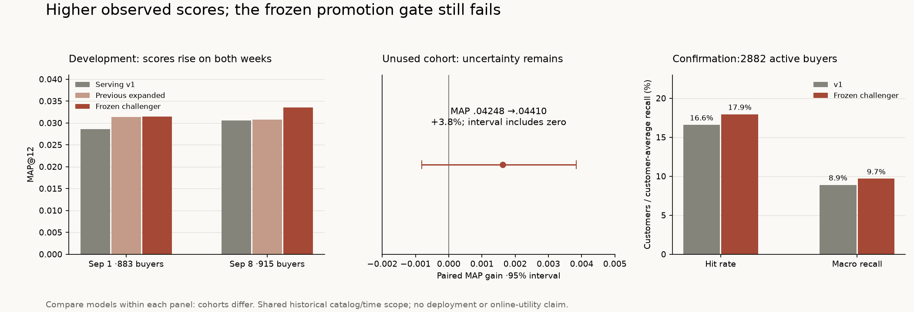

# Ranking follow-up and customer-disjoint check — 2026-10-28

Observed scores increased again, but the selected challenger still fails the frozen
promotion requirements. Development gains did not fully carry over to newly scored
customers. **No serving model, dataset, index or configuration was changed.**



## The bounded experiment

Candidate IDs, their order, eligible customers and complete unique purchased-item
truth were held fixed. The same three earlier label weeks fit each model: the first
two fit an initial model, the third selects iterations, then all three are refitted.
Target labels never select rounds or fit models. The cap stays 400 rounds, patience
30, 31 leaves/depth 6, minimum leaf size 50, learning rate .05, L2=1, seed 42, two threads.

[compare_rankers.py](../scripts/compare_rankers.py) tested exactly three new arms:

1. **Loss selection:** original 24 expanded-pool features, binary objective, selecting
   rounds by earlier-week binary log loss rather than MAP.
2. **Context binary:** the same loss-selection rule, plus three per-customer normalized
   source scores and 18 temporal/context features, totaling 45 columns.
3. **Context LambdaRank:** those 45 columns with grouped customer ranking, truncation
   15, selecting rounds by earlier-week full-truth MAP. Empty candidate groups are
   omitted from fitting groups but their customers remain in evaluation.

The [temporal feature block](../scripts/ranking_features.py) uses past-only 1/7/28-day
sales counts, observed sale ages, weekly trend, online share, normalized transaction
prices and missing-price flags, historical customer budget, purchase recency/frequency,
and family/color/department affinity. It never uses full-period catalog median prices.
Missing metadata does not match other missing values. Candidate additions and labels
are unchanged; normalization uses only a customer's candidate scores.

LambdaRank optimizes customer-group ordering; it does not make its output a purchase
probability. [LightGBM objective and ranking parameter documentation](https://lightgbm.readthedocs.io/en/stable/Parameters.html).

## Development results

These two weeks were already inspected in earlier experiments. Report every arm,
rather than choosing a different winner per week.

| Approach | Sep 1 MAP@12, 883 buyers | Sep 8 MAP@12, 915 buyers |
| --- | ---: | ---: |
| Buy-again + popularity | .025383 | .024340 |
| Fresh v1 control | .028577 | .030524 |
| Previous expanded tree, MAP selection | .031352 | .030757 |
| Binary, loss selection | .031426 | .033558 |
| Context binary, loss selection | .030283 | .035159 |
| Context LambdaRank, MAP selection | .027349 | .031691 |

Loss selection produced positive incremental MAP on both weeks, with roughly 10%
gains over v1 on each. Its hit rates were 14.27%/14.43% and macro recall 6.49%/7.44%.
The richer binary model reached the highest second-week score but fell below the
previous expanded model on the first. LambdaRank did not consistently improve MAP.
Neither larger feature count nor ranking loss is a guaranteed improvement.

Selected rounds were 33/35 for loss selection, 53/47 for context binary and 32/23
for context LambdaRank. The earlier expanded model's 21/6-round choices and scores
were reproduced exactly from the cached, unchanged candidate rows. All development
MAP intervals versus v1 still included zero; these are selection results, not proof
of a population effect. Multiple trials and recurring customers limit naive pooling.

The simpler **24-feature binary loss-selection design** was frozen for confirmation.
It gave the most consistent incremental result while avoiding the extra context
contract. This was one fixed choice, not the best model selected afterward on the
confirmation outcomes.

## Reservation before inspecting new customer outcomes

The frozen protocol is retained in the aggregate evidence. Before sampling the cohort
or reading its target outcomes, it fixed:

- Target September 9–15; training labels end August 25, September 1 and September 8.
- Sample 20,000 shoppers uniformly without replacement, seed 20261028, from sorted
  crowd shopper IDs with at least five catalog purchase events **before September 9**.
  Exclude all 5,000 original sampled shoppers using the verified crosswalk.
- Fit only the frozen challenger and a fresh v1 on the same prior cohort windows.
  Buy-again is a descriptive control. No model alternatives, retuning or resampling.
- Require at least 5% relative MAP gain, no hit/macro-recall decrease and a positive
  paired-MAP lower bound for an established gain. Flag section/history/activity MAP
  losses exceeding 10% for slices of at least 50 users; warnings need separate review.

There were 185,168 eligible past shoppers, 20,000 sampled and zero original-sample
overlap. Sampling did not condition on future activity. New user IDs were mapped
explicitly to crowd histories; missing age is unused by the chosen models. The
catalog stays fixed at 14,300 products.

Reproduction of the selection core, using the source bundle's anonymous tables:

```python
past = crowd[pd.to_datetime(crowd.purchase_date) < pd.Timestamp("2020-09-09")]
counts = past.groupby("shopper_id").size()
eligible = np.sort(counts[(counts >= 5) & ~counts.index.isin(old_users.shopper_id)].index.to_numpy())
chosen = np.sort(np.random.default_rng(20261028).choice(eligible, 20000, replace=False))
```

Persist a new user/crowd crosswalk, events through September 15 and the unchanged
source catalog/crowd, in a separate directory. The recorded cohort hash verifies the
selection without committing individual memberships. Current local reservation and
manifest are under `data/experiments/confirmation-20261028`.

This is a **customer-disjoint target-label check**, not a new calendar period,
completely independent dataset, cold-start test or full-assortment population study.
The global historical crowd log and future-selected original catalog are shared
with previous work. These customers were not previously scored as the sampled-user
labels; shared transactions may have served as historical inputs in other studies.
New-time and prospective validation remain necessary for broader claims.

## Frozen check: 2,882 active eligible buyers

Of the 20,000 past-eligible sampled customers, 2,882 bought a catalog article in the
target week and enter the declared active-buyer metric. All of their unique truth,
including unreachable items and repeats, stays in the denominator. The target
population differs from development; compare models **within this table**, not the
absolute scores across cohorts.

| Metric | Fresh v1 | Frozen challenger | Buy-again |
| --- | ---: | ---: | ---: |
| MAP@12 | .042484 | .044104 | .039199 |
| Hit rate | 16.59% | 17.94% | 13.81% |
| Macro recall@12 | 8.89% | 9.68% | 7.17% |

The challenger selected 63 rounds from the preceding validation week. Relative MAP
gain is **3.81%**, below the 5% gate. Paired MAP delta is +.001620, with 95% interval
**[−.000812,+.003840]**, using 2,000 paired customer bootstrap resamples and seed 42.
It does not establish a nonzero MAP effect. The bootstrap omits training/selection
uncertainty. Higher observed hit and recall are useful observations, not retroactive
replacement promotion criteria.

No declared material slice crossed the loss-warning threshold. MAP gains were
concentrated in histories of 5–9 events (+7.57%) and older last purchases (+11.40%).
Histories of 10+ events gained .28%, and recent purchasers 1.45%. Menswear declined
6.15% among 80 users; that is below the 10% warning threshold, not proof of no harm.
The Baby/Children slice has only eight buyers and cannot support a strong claim.
Exact counts and all slices are in the aggregate JSON.

**Disposition: unpromoted.** Both the practical MAP gate and positive-interval test
failed. No alternative was tested on these outcomes afterward. The 20,000-member
cohort is now inspected and must not be reused or relabeled as a fresh reservation.
Future reservations must account for these memberships as well as the original cohort.

## Checks, evidence and reproduction

Two existing visible Codex teammates were reused: one implemented context features;
the other independently reviewed the harness and then the frozen cohort protocol.
They found no verified leakage blocker. Checks covered synthetic future-event
invariance, exact group alignment, missing data and unchanged predictions/rounds
when target truth is mutated. Review did not inspect pending real outcomes.
Practical/interval booleans alone do not authorize promotion: material slice review
and serving integration remain separate.

```sh
uv run --with lightgbm==4.7.0 python -m scripts.compare_rankers --data-dir data/experiments/enriched-20261028 --holdout-end 2020-09-01 --holdout-end 2020-09-08 --output /tmp/ranking-development.json
uv run --with lightgbm==4.7.0 python -m scripts.compare_rankers --data-dir data/experiments/confirmation-20261028 --holdout-end 2020-09-15 --confirm --output /tmp/ranking-confirmation.json
```

Rerunning the latter reproduces an inspected check; it does not create another fresh
confirmation. Reports are refused under the input directory and input SHA-256 values
are checked before/after. Optional LightGBM remains isolated, without a project
runtime dependency. Default model export is disabled; explicit local experimental
models, memberships, per-customer evidence and caches stay outside Git.

The actual run cached immutable numeric candidate arrays locally, with pickle loading
disabled. A repeated-decompression bug in the temporary reader was corrected and the
same protocol restarted **before any fits or outcomes**; no model/label rule changed.
The confirmation helper was added after protocol freeze to implement its rules; the
selected fitter/candidate algorithms and declared gates stayed unchanged.

[Aggregate results, frozen protocol and all slices](research/ranking-followup.json)
retain exact numbers and provenance. Serving input/model hashes were verified
unchanged. **446 offline tests passed**, one integration test deselected, Ruff lint
and formatting passed. No production rollout, full load test or online utility study
was performed.
