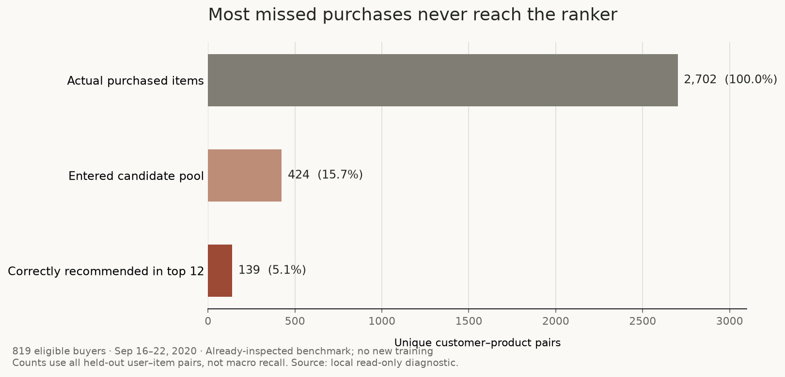

# Recommendation quality: research and implementation direction

Research date: 2026-10-28. Inspected application revision: `4edafb8`.

The limited tuning round failed its promotion gate. That does **not** establish that H&M is broken or that useful improvement is impossible. Keep the purchase benchmark, improve retrieval and the information retained during preparation, and separately measure the discovery tasks the product offers. No replacement model is promoted by this research.

## What the numbers mean

MAP@12 measures the positions of exact articles purchased the following week. It is not satisfaction or a purchase probability. For example, one relevant article at rank three gives AP 1/3; if only one of ten customers gets that result, their MAP is .0333. A useful substitute can receive zero purchase credit.

The official H&M scoring excludes customers who do not purchase in the target period, just as our evaluator does. Official scoring also includes target-active customers without training history; ours requires prior purchases. Thus inactive-customer averaging does not explain a leaderboard difference. Our smaller prepared catalog, selected customers and earlier evaluation week prevent direct comparisons. [Official evaluation](https://www.kaggle.com/c/h-and-m-personalized-fashion-recommendations/), [local evaluator](../scripts/evaluate.py).

A cosine similarity of .3 and a negative learned ranking score have different meanings again. The former measures embedding alignment; the latter is a linear model output used for ordering. Neither is a calibrated quality percentage. See [encoder](../src/clothes_recommender/embeddings.py) and [ranker](../src/clothes_recommender/recommenders/learned.py). The original [CLIP paper](https://proceedings.mlr.press/v139/radford21a/radford21a.pdf) does not make our returned raw cosine a relevance probability.

Small decimals are normal for this particular prediction task, but that alone does not make our system good. The second-place authors reported ensemble leaderboard MAP .0368 and used two to three months of history. Their result is an author report on a different population/week, not a target or ceiling for our subset. The previously quoted approximate winning .038 was not independently verified as an exact private score. [Original second-place report](https://www.kaggle.com/competitions/h-and-m-personalized-fashion-recommendations/writeups/hello-world-2nd-place-solution).

## The measured bottleneck

A read-only replay of the **already inspected** September 16–22, 2020 benchmark reproduced these results. This is descriptive diagnosis, not fresh confirmation or a new training experiment.

| Stage | Unique customer–article pairs | Share of all actual purchases |
| --- | ---: | ---: |
| Actual held-out purchases | 2,702 | 100% |
| Present in generated candidates | 424 | 15.69% |
| Correctly recommended in top 12 | 139 | 5.14% |

There were 819 eligible buyers, 114 with any correct recommendation: **hit rate 13.92%**, MAP **.030179**, macro recall **7.63%**. Pair-weighted recall is 5.14%; it differs from macro recall because the latter gives each customer equal weight. Median pool size was 104.

**2,278 actual purchases never reached the ranker.** Changing only the ranker cannot recover them. Another 285 reachable purchases were not selected, so ranking also needs improvement. An ideal ordering with access to future truth would yield candidate-oracle MAP .17877 on this fixed pool. This is a diagnostic upper bound, not a promised attainable score; candidate micro recall is not itself a MAP bound.

Only 89/2,702 truth pairs were repeats of a customer's observed historical article. Buy-again remains an essential baseline but cannot solve most novel-item misses here. These counts are conditional on the prepared history/catalog, not general H&M repurchase rates.

The data is larger than the 5,000-user UI sample suggests: **3,035,225 crowd transactions from 478,818 shoppers** support collaborative signals within the 14,300-product catalog. The sampled users have 59,040 transactions. See the existing [audit](recommendation-audit.md) and [tuning record](recommendation-tuning.md).

## What preparation discards

Direct inspection of [prepare_data.py](../scripts/prepare_data.py) establishes these limitations:

- Transactions discard sales channel and per-event prices. The displayed product price is a full-period median, so it must not become a purported historical as-of feature.
- Customers retain ID and age, dropping postal code and membership/activity fields. Current v1 does not use age.
- Products retain broad section/type/color/text, but discard original product code, department and finer index fields.
- Sampled `user_id` enumerates selected customers; crowd `shopper_id` categorizes all customers. Their integers are **different identity spaces**, and no crosswalk is saved. A global user-factor model must first persist a validated mapping or infer personal factors from history. Current item-to-item CF does not join those IDs and is unaffected.

These are plausible missed inputs, not demonstrated causal explanations for today's score. Recover only fields required by a declared experiment; keep original customer identifiers and sensitive attributes out of public output and Git.

Cohort/catalog construction uses the full selected observation window, including the minimum-purchase filter and articles bought by sampled customers. Evaluation is therefore conditional on future-informed population selection. Future work should freeze eligibility from past data and report cold/new-item outcomes separately. This selection can distort difficulty; it is not evidence that all current feature chronology leaks. The inspected evaluator/ranker cuts transactions before each target week and rejects models trained into their holdout.

## What successful H&M systems suggest testing

The most relevant original result is from the third-place author: expanding candidates **together with retrieval-source flags and ranks** increased their single-model private MAP .02855→.03262. Expanding without those features hurt local CV. A separately added, past-only weekly BPR user–item similarity feature increased .03363→.03510. These are author ablations, not transferable or additive gains. [Original third-place report](https://www.kaggle.com/competitions/h-and-m-personalized-fashion-recommendations/discussion/324129).

Our wider-pool trials are therefore insufficient to dismiss retrieval work. First test source flags/ranks/support and seed recency on a fixed pool; then test complementary channels. Useful candidates include recent co-purchases, attribute/family matches and a latent user–item score. Preserve factual explanations and distinguish observed recent sales from stock availability.

The second-place approach also used multi-horizon counts, richer metadata and staged retrieval/ranking. Twelve weeks alone is not an established cause of failure. Our fixed 100-round shallow-tree trials did not reproduce those systems' representations or fitting procedures. More history, more labeled weekly snapshots, better features and greater model capacity are separate interventions; ablate them separately rather than promising a neural-model cure.

The rejected rich24 challenger remains rejected: on September 9–15 it gained 2.81% relative MAP, below the declared 5% threshold, and reduced macro recall. Its paired MAP interval crossed zero. This is evidence about that frozen design, not an exhaustion of recommendation methods.

## Would another dataset be better?

| Dataset | Useful purpose | Why it is not a direct upgrade |
| --- | --- | --- |
| H&M | Fashion purchase prediction with joinable article photos/text | Keep and enrich. Historical transactions do not supply impressions, dislikes, current inventory or search relevance judgments. |
| Amazon Reviews 2023 | Review-based preferences and multimodal item representations | Review time is not purchase time; missing reviews are not missing purchases. Parent-ASIN joins and image coverage require auditing. |
| Dressipi / RecSys 2022 | Predict a purchase from an ongoing fashion browsing session | No persistent user ID; content labels are anonymized. Its session task and candidate protocol differ from our full-catalog weekly task. |
| Amazon ESCI | Judged text product-search relevance | General shopping queries, supplied candidate lists and text metadata; no user histories or released product images. |
| FARFETCH / Polyvore / FashionGen / DeepFashion | Specific click, outfit, generation or visual-retrieval tasks | Different targets; archive access, image availability and usage conditions vary. They do not automatically add personal purchase labels. |

Amazon's published raw Amazon_Fashion counts are about 2.5M reviews from 2.0M users: **approximately 1.25 reviews/user**, derived from rounded totals, not a median. A fashion name and large total do not imply dense personal histories. Clothing/Shoes/Jewelry is broader: 66M reviews, 22.6M users and 7.2M items. Its published 5-core subset has 23.1M interactions, 2.5M users and 715K items, but selects a different, warmer population. A core filter built using future interactions can contaminate population selection. [Owner schema/statistics](https://amazon-reviews-2023.github.io/), [5-core protocol](https://amazon-reviews-2023.github.io/data_processing/5core.html).

Dressipi provides 1.1M fashion purchasing sessions, with a chronological split, but cannot be joined back to H&M products. Keep any experiment separate. [Organizer specification](https://www.recsyschallenge.com/2022/dataset.html). ESCI supplies Exact/Substitute/Complement/Irrelevant query judgments and is suitable for a separate text-search benchmark. Its provided-candidate ranking score does not measure full-catalog retrieval or personalized purchases. [Original repository/schema](https://github.com/amazon-science/esci-data).

Availability was checked without accounts or full downloads. Four bounded Range requests to original-owner Amazon review/metadata files returned 206, and two image URLs returned 200; this does not establish representative join coverage. ESCI LFS objects responded to HEAD. Dressipi delivery requires a form not submitted here. Current FARFETCH/FashionGen archive delivery was not established; Polyvore's original image URLs are unavailable. Original terms and permission for public product display must be resolved before any migration; a code license or reachable photo URL is insufficient. Historical FARFETCH click data and its separate outfit challenge should not be conflated. [2021 click-task paper](https://parklize.github.io/publications/ECML2021.pdf), [2022 outfit-task organizer](https://sigir-ecom.github.io/ecom2022/data-task.html), [FashionGen paper](https://arxiv.org/abs/1806.08317), [DeepFashion owner](https://mmlab.ie.cuhk.edu.hk/projects/DeepFashion.html). [Amazon owner files](https://huggingface.co/datasets/McAuley-Lab/Amazon-Reviews-2023/tree/main/raw), [Dressipi download](https://dressipi.com/downloads/recsys-datasets/), [Polyvore original](https://github.com/xthan/polyvore-dataset).

## Implementation order and acceptance

1. **Repair the experiment input contract.** Preserve an explicit identity crosswalk and experiment-required article/event fields, with synthetic join/chronology tests. Regenerate separately; do not silently change the retained benchmark or serving data.
2. **Measure and improve retrieval.** Report incremental reach by source, source overlap, candidate sizes, per-customer oracle and runtime. Test fixed-pool provenance before bounded candidate expansion; then add time-aware co-purchase/family and past-only latent signals. Evaluate complete truth, including unreachable purchases.
3. **Fit a stronger ranker deliberately.** Use time-aware feature snapshots and a declared, bounded early-stopping/capacity search against repeat, recent popularity and freshly fitted v1. Never inject future positives that retrieval missed. Source-aware ranking and retrieval need both isolated and end-to-end comparisons.
4. **Evaluate discovery directly.** Build blinded graded text/photo query judgments, with hard type/color/budget constraints, legitimate no-result cases, out-of-catalog photos and near-duplicate grouping. Report judged-pool NDCG, top-result success, violations, coverage and latency. The current photo index covers 3,537/14,300 products (24.7%); that limits visual search but does not explain transaction-only v1 MAP. A fashion-specialized encoder is a candidate for controlled comparison, not a guaranteed purchase improvement. [FashionCLIP authors](https://github.com/patrickjohncyh/fashion-clip).
5. **Collect real product feedback.** Versioned shown-item/rank events, visible impressions, opens, saves/likes and optional skip reasons can support session and taste evaluation. Missing purchase alone is not dislike. Measure assistant constraint preservation and grounded product references separately from fluent wording. Use prospective task studies and, when traffic permits, randomized comparisons for actual user benefit. [Implicit-feedback research](https://yifanhu.net/PUB/cf.pdf), [selection-bias research](https://proceedings.mlr.press/v48/schnabel16.html).

Before selection, freeze the population/catalog rule, target, candidate budget, metric denominators, latency budget and material slices. Retain the earlier promotion requirements: at least 5% relative MAP gain, no aggregate hit/macro-recall loss, and a paired interval excluding zero for an established uplift claim. Report per-week results; cluster uncertainty appropriately when users repeat across weeks. A customer bootstrap on one week does not capture training or model-selection uncertainty.

All September selection/confirmation/final windows have now been inspected. None is fresh confirmation for a newly chosen design. Use a genuinely withheld period/cohort with declared construction, or explicitly label a nested retrospective study and require later prospective validation.

Do not manufacture higher numbers by shrinking the candidate exam, dropping unreachable customers, filtering the cohort using future activity or replacing purchase truth with easier labels under the same metric name. Sampled-negative metrics can even reverse model ordering. [Krichene and Rendle, KDD 2020](https://research.google/pubs/on-sampled-metrics-for-item-recommendation/).

## Research scope and verification

Three visible Orca Codex workers separately examined original H&M approaches, alternative datasets/access and evaluation methodology. Their native conversations were retained. The coordinator independently inspected preparation/evaluation code, replayed the already-inspected aggregate funnel, checked primary sources and reviewed the exported chart. Worker metric/chronology/identity harnesses passed six and twelve synthetic assertions respectively; these are research checks, not a new application test run.

No application code, serving data, production model, index, provider configuration or project dependency changed. No historical leaderboard result was reproduced; no new dataset, encoder or recommendation model was trained. Real taste/search judgments, exposure bias magnitude, current stock and online benefit remain unmeasured. The full implementation suite's previously recorded 342 passes are unchanged historical evidence, not proof of research hypotheses.
