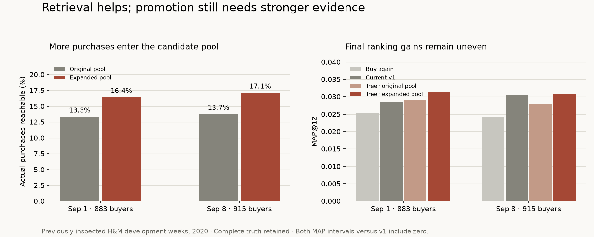

# Complementary retrieval experiment — 2026-10-28

The new channels recover substantially more candidate purchases on both development
weeks. The end-to-end challenger improves observed hit rate and recall, but MAP gains
are uneven and uncertain against v1. **No model is promoted.** Serving data, model,
index and configuration remain unchanged.



## Prepared inputs and source verification

An isolated enriched bundle was generated at `data/experiments/enriched-20261028`
using 12 weeks from July 1, 2020, 5,000 sampled customers and seed 42. It contains
14,300 products, 59,040 sampled purchases, 3,035,225 crowd purchases and 757,633
co-purchase links. Every retained field in products/users/purchases/crowd/links
was compared with the serving bundle and matched, ignoring storage dtype/order.
The new anonymous crosswalk was also checked against actual crowd histories,
including event prices and sales channels; joins matched exactly.

The original local raw cache had one truncated Parquet shard. Preparation rejected
it before writing outputs. A separate verified source directory was assembled:
valid files were linked, and the truncated file was reconstructed in an isolated
copy. All nine raw files match published LFS SHA-256 checksums at immutable mirror
revision `c335faf3386d3c760997c37ba4cc1b0d90265c1f`. Source metadata and repair records
remain locally in `data/experiments/raw-verified-20261028/source.json`; original raw
cache files were not changed. This does not explain the earlier low metrics: the
new prepared bundle reproduces the retained data. [Pinned source](https://huggingface.co/datasets/dinhlnd1610/HM-Personalized-Fashion-Recommendations/tree/c335faf3386d3c760997c37ba4cc1b0d90265c1f).

## Channels and chronology

[retrieval_channels.py](../scripts/retrieval_channels.py) implements three fixed,
offline-only channels, with at most 50 candidates each:

- **Family:** actual shared `product_code`, recent personal seeds and recent catalog
  popularity. A matching name alone is insufficient.
- **Recent basket:** same-day catalog co-purchases over 28 days, deduplicated within
  baskets, with at least two supporting baskets and support/lift weighting.
- **Latent:** seeded 32-factor sparse SVD over earlier crowd events, recency and
  popularity damping, then personal-history fold-in. This is SVD, **not BPR or ALS**.
  Sampled user IDs are never joined to crowd integer IDs.

Channels internally remove future events, exclude already-owned articles, require
past-observed catalog items and return no popularity fillers. The existing base
pool still includes buy-again. Original future-informed cohort/catalog selection
is unchanged; comparisons remain conditional on this sample and catalog.

[compare_retrieval.py](../scripts/compare_retrieval.py) appends explicit experimental
IDs through the shared feature builder. Normal serving requests pass no extras.
All eligible users and their complete unique purchased-item truth remain in every
metric, including targets unreachable by any channel.

## Retrieval results

| Holdout end | Eligible buyers | Original reachable pairs | Expanded reachable pairs | Original → expanded candidate recall | Median pool size |
| --- | ---: | ---: | ---: | --- | --- |
| Sep 1 | 883 | 433 /3,251 | 533 /3,251 | 13.32% →16.39% | 104 →156 |
| Sep 8 | 915 | 449 /3,267 | 559 /3,267 | 13.74% →17.11% | 104 →158 |

These are pair-weighted candidate recall values, not customer-macro recall or
MAP. Additional correct pairs over the base were family 14/11, basket 29/33 and
latent 68/77 respectively. Those source contributions overlap; union gains are
100/110, not their sums. Candidate-oracle MAP increases .15197→.18642 and
.17466→.21093, an upper bound requiring future truth, not a forecast.

## End-to-end ranking control

Three earlier labeled weeks train each model. Tree selection fits the first two,
early-stops on full-truth MAP of the third, then refits all three. Both tree arms
use the same 24 columns: v2's 15 features plus flag/rank/native score for each new
channel. The base arm receives new-channel information for its original items,
while the expanded arm can also rank new candidates. The original ten features
fit a fresh v1 control, reproducing earlier metrics to 1e-12.

The tree budget was fixed before results: binary LightGBM, cap 400 rounds,
31 leaves/depth 6, minimum leaf size 50, learning rate .05, L2=1, seed 42, two threads,
30-round temporal early stopping. The separately selected iterations were 28/21
(base/expanded) for Sep 1 and 1/6 for Sep 8. More available capacity does not mean
all 400 rounds were selected. No target labels fitted models or selected iterations.

| Approach | Sep 1 MAP@12 | Sep 8 MAP@12 |
| --- | ---: | ---: |
| Buy-again + recent popularity | .025383 | .024340 |
| Fresh v1 | .028577 | .030524 |
| Tree, original pool | .028892 | .027926 |
| Tree, expanded pool | .031352 | .030757 |

| Expanded tree vs v1 | Sep 1 | Sep 8 |
| --- | --- | --- |
| Relative MAP gain | +9.71% | +0.76% |
| Hit rate | 12.00% →14.04% | 11.91% →14.10% |
| Macro recall | 5.61% →6.49% | 6.31% →7.52% |
| Paired MAP delta, 95% interval | +.002775 [−.001229,+.006995] | +.000233 [−.004815,+.005283] |

Paired expanded-minus-base-tree MAP differences were +.002460
[+.000347,+.004962] and +.002831 [−.001432,+.007585]. The first comparison
supports a pool-expansion gain within that week; neither week establishes an
expanded-model gain over v1. Intervals use 2,000 paired customer bootstrap
resamples/seed 42 and omit training/model-selection uncertainty. Do not pool them
as independent customer samples when customers can recur across weeks.

Both weeks are already inspected development data, not fresh confirmation.
The second week's MAP gain is below the earlier 5% practical threshold, and
both v1 comparison intervals include zero. No independent confirmation cohort
was consumed for this candidate. The selected design is not ready for promotion.
This result tests only the stated channels, representation and fitting protocol;
it does not establish that another ranker or richer features cannot improve.

## Runtime, checks and reproduction

Channel construction took approximately 42–46 seconds per target snapshot. Candidate
and feature generation p50/p95 was about 7.7/9.0 milliseconds per customer on this
local sequential run. These timings exclude shared CF construction, tree fitting,
HTTP/UI, provider latency and concurrent traffic; they are not serving SLAs.
The SVD and basket matrices are fitted once per snapshot, not on each customer call.

Two visible Codex teammates implemented preparation and channels; the preparation
teammate then reviewed the integration read-only. An extra review task was cancelled
at the Owner's two-teammate instruction and contributed no findings or code. The
accepted integration review found no verified blockers; a real LightGBM 4.7.0 smoke
confirmed that changing target truth does not change predictions/selected rounds.
All native conversations were retained.

```sh
uv run python -m scripts.prepare_data --archive data/experiments/raw-verified-20261028 --data-dir data/experiments/enriched-20261028
uv run python -m scripts.compare_retrieval --data-dir data/experiments/enriched-20261028 --holdout-end 2020-09-01 --output /tmp/reach-sep1.json
uv run --with lightgbm==4.7.0 python -m scripts.compare_retrieval --data-dir data/experiments/enriched-20261028 --holdout-end 2020-09-01 --rank --output /tmp/rank-sep1.json
```

Repeat the comparison with `--holdout-end 2020-09-08`. The actual run reused
immutable per-window candidate rows in memory for overlapping training windows;
the CLI recomputes them. LightGBM stayed in an isolated existing temporary install,
with no project dependency or serving artifact change. Reports must be written
outside the prepared input directory; CLI input hashes are checked before/after.
The repeat control was computed afterward on identical cohorts, then added as a
reporting-only harness control; no challenger was retuned. A missing optional
LightGBM now fails before expensive preparation/model work.

[Aggregate results and run protocol](research/retrieval-ablation.json) retain exact
metrics, paired intervals, source counts, timings and code hashes from the run.
No raw IDs, individual predictions or model binaries are committed. Retained
serving input/model SHA-256 hashes were independently verified unchanged.

The next model experiment should focus on converting this additional reach into
consistent early-rank gains; a later frozen candidate still needs independent
confirmation, material-slice checks and serving integration/latency validation.

Verification completed with **417 offline tests passed**, one integration test
deselected, and passing Ruff lint/format checks. Coverage includes CSV/Parquet
equivalence and malformed shards, real and synthetic identity joins, future-row
isolation, deduplicated baskets, sparse seeded factorization, candidate/score
alignment, unchanged v1 behavior, full truth and earlier-week model selection.
